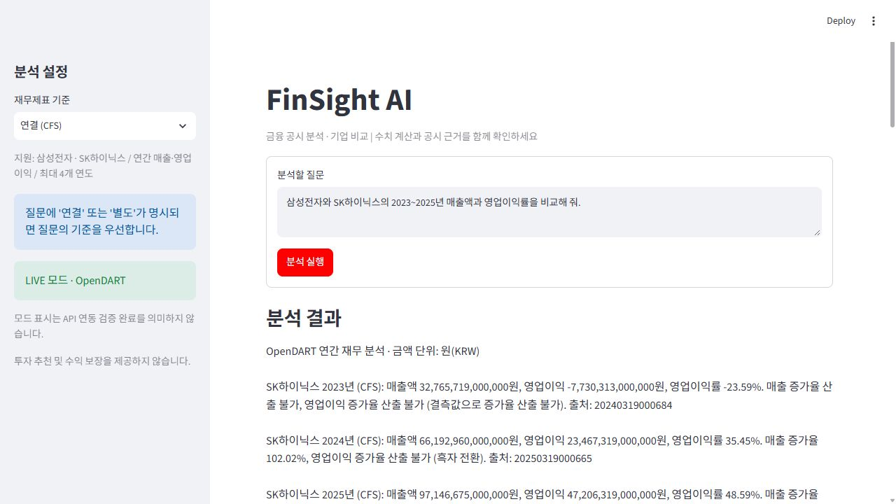
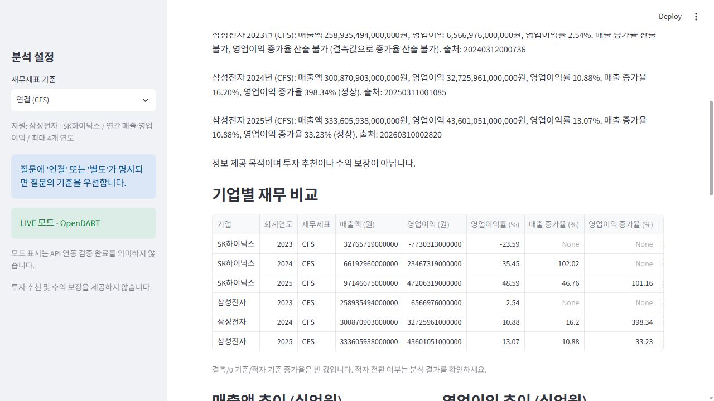
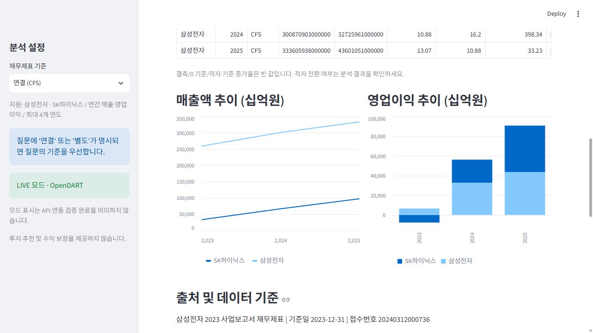
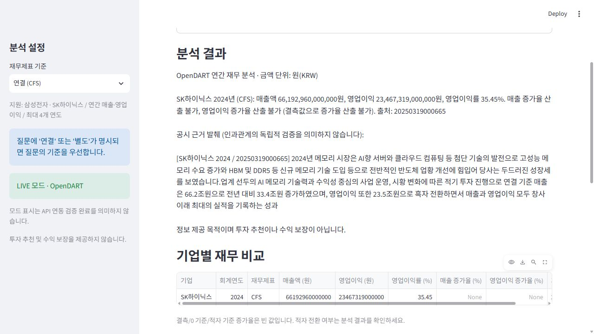
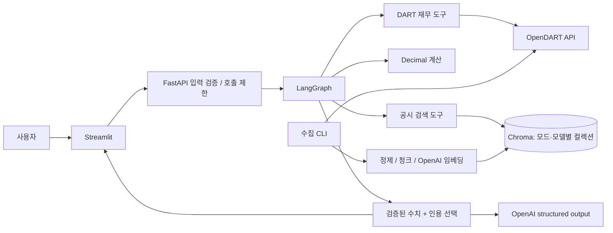
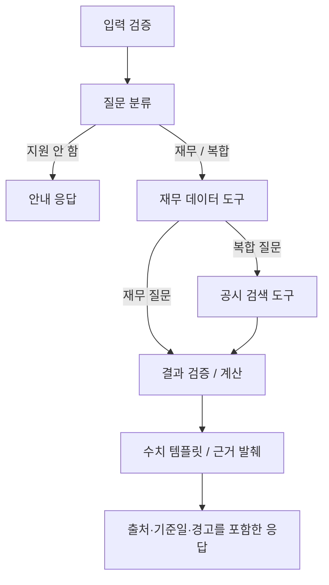

# FinSight AI

삼성전자와 SK하이닉스의 연간 실적을 묻는 질문에 답하는 금융 분석 Agent입니다. 재무 수치는 OpenDART에서 가져와 Python으로 계산하고, 실적의 원인은 해당 연도 사업보고서에서 찾은 문장을 그대로 인용해 답합니다.

Python · FastAPI · LangGraph · Chroma · OpenAI API · Streamlit

## 왜 만들었나

LLM에게 기업 실적을 바로 물어보면 회계연도, 연결/별도 기준, 단위, 출처가 쉽게 뒤섞입니다. 그래서 숫자는 LLM이 만들지 않게 했습니다. 금액은 OpenDART 응답을 `Decimal`로 계산하고, 원인 설명은 기업·연도가 맞는 공시에서 근거를 찾았을 때만 보여 줍니다. 근거가 없으면 없다고 답합니다.

## 실행 화면

2026-10-31에 실제 API 키로 FastAPI와 Streamlit을 로컬에서 띄워 찍은 LIVE 모드 화면입니다. 재무는 OpenDART에서 실제로 조회했고, 공시 검색은 미리 수집·임베딩해 둔 SK하이닉스 2024년 사업보고서(833개 청크)를 사용했습니다.

질문 입력과 재무 계산 결과



두 기업의 재무 비교표



매출액·영업이익 추이와 DART 출처



공시에서 찾은 근거 문장



API 키 없이도 Mock 모드로 실행할 수 있습니다. Mock 화면의 수치는 합성 데이터입니다.

## 할 수 있는 것

| 기능 | 구현 | 확인한 방법 |
|---|---|---|
| 기업 고유번호 조회·종목코드 매핑 | OpenDART corpCode.xml | Mock HTTP 테스트, 실제 조회 |
| 연간 연결/별도 재무 조회 | fnlttSinglAcntAll.json, 보고서 코드 11011, CFS/OFS | 연결 2023~2025년은 원문과 자동 대조, 별도는 오프라인 테스트 |
| 매출·영업이익·이익률·전년 대비 증가율 | Decimal 계산, 결측·0·적자 처리 | 단위·통합 테스트 |
| Agent | Typed State, 조건부 라우팅, 역할별 도구, 결과 검증 | LangGraph 실행 테스트 |
| 공시 수집과 검색 | list.json/document.xml → 청크 → OpenAI 임베딩 → Chroma | 원본 XML 24개 정제, SK하이닉스 2024년 실제 수집·검색 |
| 공시 근거 답변 | LLM이 인용할 문장을 고르고, 서버가 원문과 글자 단위로 대조 | 실제 질문 24개 실행 |
| API / UI | FastAPI, Streamlit 비교표·차트·출처·오류 표시 | 테스트와 로컬 smoke |

지원 범위는 삼성전자와 SK하이닉스, 2015년 이후 마감된 연간 회계기간, 한 번에 최대 4개 연도입니다. 전년 대비 계산에 필요한 이전 연도도 이 4개에 포함됩니다. '최근'은 서울 기준 올해의 전년도를 뜻하고, 아직 공시가 없으면 더 오래된 데이터로 바꿔 답하지 않습니다. 분기 실적, 순이익, 주가, 투자 추천은 다루지 않습니다.

## 검증 결과

- **재무 수치:** 연결 재무 원문 12개 값(2개 기업 × 2023~2025년 × 매출액·영업이익)과 계산 가능한 비율 17개가 모두 원문에서 따로 뽑은 값과 일치했습니다(2026-10-29). 자동 대조 결과이며 사람이 회계 검토를 한 것은 아닙니다. 자세한 절차는 [Baseline](docs/BASELINE.md)에 있습니다.
- **테스트:** 오프라인 pytest 76개 통과, 2개 skip, Ruff 통과(2026-10-31). skip된 2개는 실제 API 연동 테스트로, 키를 넣은 별도 프로세스에서 따로 실행해 통과했습니다.
- **공시 XML 정제:** 실제 공시 원문의 `R&D`, `S&P` 같은 표기 때문에 파싱이 실패하던 문제를 고쳤고, 보관한 원본 24개가 모두 정제를 통과합니다. [XML 수정 기록](docs/XML_REPAIR.md)
- **아직 못 한 것:** RAG 답변 24개에 대한 사람의 정답 검토는 하지 않았습니다. 인용 문장이 원문에 있다는 것과 그 문장이 질문에 대한 답이라는 것은 다른 문제여서, 사례별로 [RAG 결과 검토](docs/RAG_REVIEW.md)에 따로 정리했습니다.

## 역할 분담

요구사항 정의, 설계 방향 결정, 구현 지시, 테스트 기준 검토와 결과 확인은 제가 했습니다. 코드 작성과 자동 테스트, 실제 API 연동 검사 실행은 AI 코딩 도구인 Codex가 했습니다.

## 빠른 시작 (API 키 없이 Mock 모드)

Python 3.12에서 확인했습니다(Windows, 3.12.14). 3.11 이상 3.13 미만을 지원하도록 설정했지만 3.11과 Linux/macOS에서는 아직 돌려 보지 않았습니다.

```powershell
py -3.12 -m venv .venv
.\.venv\Scripts\python.exe -m pip install -e ".[dev]"
Copy-Item .env.example .env
.\.venv\Scripts\python.exe scripts/doctor.py
```

`py` 런처가 없으면 `python -m venv .venv`를 쓰면 됩니다. Linux/macOS에서는 `.venv/bin/python`을 사용하세요. `doctor.py`는 키가 설정됐는지만 보여 주고 값은 출력하지 않습니다.

터미널 1:

```powershell
.\.venv\Scripts\python.exe -m uvicorn finsight.api:app --host 127.0.0.1 --port 8000
```

터미널 2:

```powershell
.\.venv\Scripts\python.exe -m streamlit run ui/app.py --server.address 127.0.0.1 --server.headless true
```

[대시보드](http://127.0.0.1:8501) · [API 문서](http://127.0.0.1:8000/docs)

UI에는 키를 입력하지 않습니다. Streamlit은 FastAPI 서버에 질문만 보내고, Mock/LIVE 모드는 서버의 환경변수로 정해집니다. API 서버 주소를 바꾸려면 `FINSIGHT_API_URL`을 설정하세요.

Chroma는 별도 서버 없이 애플리케이션 프로세스 안에서 `PersistentClient`로 동작합니다. 기본 저장 위치는 `data/chroma`이고 Mock/LIVE 모드와 임베딩 모델별로 컬렉션이 나뉩니다. 두 터미널 모두 프로젝트 루트에서 실행하세요.

## LIVE 모드

`.env`에 `FINSIGHT_MODE=live`, `DART_API_KEY`, `OPENAI_API_KEY`를 설정합니다. DART 키가 없으면 서버가 시작되지 않으며, 조용히 Mock으로 바뀌지도 않습니다. 재무 질문만 한다면 OpenAI 키는 필요 없습니다.

공시 근거를 쓰려면 먼저 해당 기업·연도의 사업보고서를 수집해야 합니다. 이때 정제된 공시 텍스트가 OpenAI 임베딩 API로 전송되고 비용이 발생합니다.

```powershell
.\.venv\Scripts\python.exe scripts/ingest.py --company 삼성전자 --year 2024
.\.venv\Scripts\python.exe scripts/ingest.py --company SK하이닉스 --year 2024
```

2023~2025년 전체의 원인을 분석하려면 기업·연도마다 수집해야 합니다. 수집은 OpenDART 공식 API가 제공하는 문서만 사용합니다. 공시 원문과 벡터 DB는 Git에 올리지 않습니다.

## 질문 예시 (Mock 합성 데이터)

아래는 Mock 모드에서 실제로 실행한 결과이며, 수치는 실제 기업 실적이 아닙니다.

**`삼성전자의 2024년 영업이익이 전년 대비 얼마나 증가했어?`**

- 2023년 영업이익(합성): 10,000,000,000원
- 2024년 영업이익(합성): 18,000,000,000원
- 계산: `(18 - 10) / 10 × 100 = 80.00%`
- 출처: `MOCK-삼성전자-2023`, `MOCK-삼성전자-2024`

**`SK하이닉스 2024 영업이익 전년 대비 증가율`**

전년 영업손실 -50억 원, 당해 영업이익 150억 원 → 증가율 대신 **흑자 전환**으로 표시합니다.

**`SK하이닉스 2020 실적 원인`**

해당 연도의 데이터와 문서가 없으므로 원인을 추측하지 않고 근거가 없다고 안내합니다.

실제 데이터로 실행한 답변 원본은 [Baseline 실행 결과](evaluation/baseline/2026-10-29/rag-results.json)에 있습니다.

## 테스트

```powershell
.\.venv\Scripts\python.exe -m pytest -q --junitxml=data/validation/pytest-results.xml
.\.venv\Scripts\python.exe scripts/evaluate.py
.\.venv\Scripts\python.exe scripts/smoke.py
.\.venv\Scripts\python.exe -m ruff check finsight ui scripts tests
```

오프라인 테스트 76개는 Mock과 fixture를 사용합니다. 실제 API를 호출하는 테스트 2개(`test_live_dart`, `test_live_ingestion_and_semantic_search`)는 비용과 키가 필요해서 기본적으로 건너뜁니다.

```powershell
$env:RUN_LIVE_TESTS="1"
.\.venv\Scripts\python.exe -m pytest tests/test_live.py -v
```

Mock 질문 평가 24개는 라우팅, 표 행 수, 합성 데이터 표시, 인용 일치, 결측 처리, 일부 계산값을 확인합니다. 24/24는 회귀 검사 결과일 뿐 실제 금융 정확도나 검색 품질 점수가 아닙니다. Mock은 256차원 문자 해시 임베딩을, LIVE 모드는 OpenAI 임베딩을 쓰고 저장 컬렉션도 분리돼 있습니다.

- [평가 질문 24개](evaluation/questions.json) / [실행 결과](evaluation/results.json)
- [pytest 결과](evaluation/pytest-results.xml) / [서버 smoke 결과](evaluation/smoke-results.json)
- [검증 방법](docs/VALIDATION.md)

<details>
<summary>이전 테스트 기록</summary>

- 2026-10-31 XML 수정 전 새 가상환경: 69개 통과·2개 skip, Mock 질문 평가 24/24.
- 2026-10-29 Baseline: 회귀 56개 통과·2개 skip, 실제 연동 1개 통과·1개 실패(XML 정제), 평가 도구 12개 통과. XML 실패는 10-31에 고쳤습니다.
- 2026-10-27 첫 로컬 실행: 53개 통과·2개 skip, Mock 질문 평가 24/24, FastAPI/Streamlit HTTP smoke, Ruff·compileall·pip check 통과.

</details>

## 구조

```text
finsight/
  config.py       환경변수·설정 검증
  models.py       입력/응답/출처 스키마
  dart.py         호출 제한·타임아웃·재시도를 갖춘 DART 클라이언트
  finance.py      금액 정규화, 기간·중복 검증, Decimal 계산
  rag.py          원문 정제, 청크, 임베딩, Chroma
  workflow.py     Typed State와 LangGraph 그래프
  api.py          입력 검증, 호출 제한, 오류 처리
  mock.py         합성 fixture
ui/app.py         Streamlit
scripts/          설정 진단, 공시 수집, 평가, HTTP smoke
tests/            계산·DART·RAG·워크플로·API·UI·실제 연동 테스트
evaluation/       평가 질문과 실행 결과
docs/             설계, 검증, 배포, 한계
```

FastAPI는 타입 기반 API 계약, LangGraph는 분기와 상태 관리, Chroma는 로컬 벡터 검색, Streamlit은 빠르게 만들 수 있는 데이터 UI라서 골랐습니다. 숫자 답변을 LLM에서 떼어 놓은 덕분에 비용이 줄고, 결과가 재현 가능하고, 숫자를 지어낼 여지가 없어졌습니다. 범위가 작은 MVP라서 Multi-Agent나 LLM의 자유로운 도구 선택은 넣지 않았습니다. 자세한 이유와 단점은 [기술 결정](docs/DECISIONS.md)에 적었습니다.





## 한계

- 질문 분류는 정해진 규칙으로 하기 때문에 자유로운 자연어를 다 이해하지는 못합니다. '전년 대비', '증가', '성장' 같은 표현이 있을 때만 전년 데이터를 함께 조회합니다. 그래서 "2024년 실적 원인"처럼 당해 연도만 묻는 질문에서는 증가율이 나오지 않을 수 있습니다.
- 전년에 영업손실이었다가 흑자로 돌아선 경우에는 증가율을 숫자로 내지 않습니다.
- 연결/별도와 통화는 구분하지만, 회계정책 변경이나 재작성에 따른 비교 가능성까지 판단하지는 않습니다.
- 공시 인용은 관련 문장을 그대로 발췌한 것이며, 원인을 종합해 요약하거나 사실 여부를 따로 검증하지 않습니다.
- Docker, CI, 클라우드 배포, MCP는 아직 없습니다.

[배포 메모](docs/DEPLOYMENT.md) · [한계와 다음 단계](docs/LIMITATIONS.md)

## 참고 문서

- [OpenDART 전체 재무제표](https://opendart.fss.or.kr/guide/detail.do?apiGrpCd=DS003&apiId=2019020)
- [OpenDART 공시 검색](https://opendart.fss.or.kr/guide/detail.do?apiGrpCd=DS001&apiId=2019001)
- [OpenDART 공시 원문](https://opendart.fss.or.kr/guide/detail.do?apiGrpCd=DS001&apiId=2019003)
- [LangGraph StateGraph](https://reference.langchain.com/python/langgraph/graph/state/StateGraph/add_conditional_edges)
