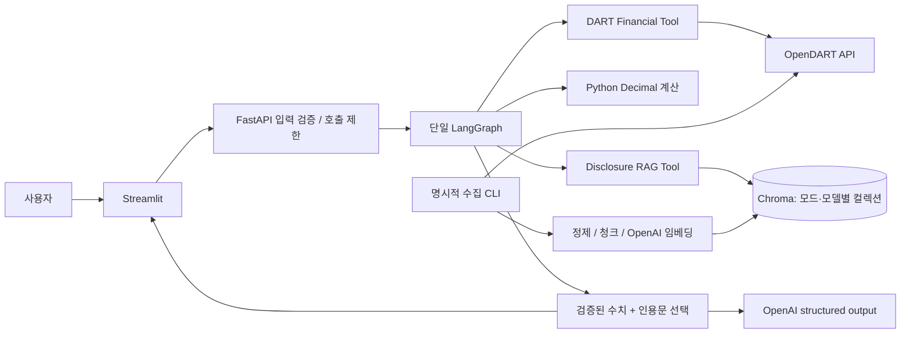
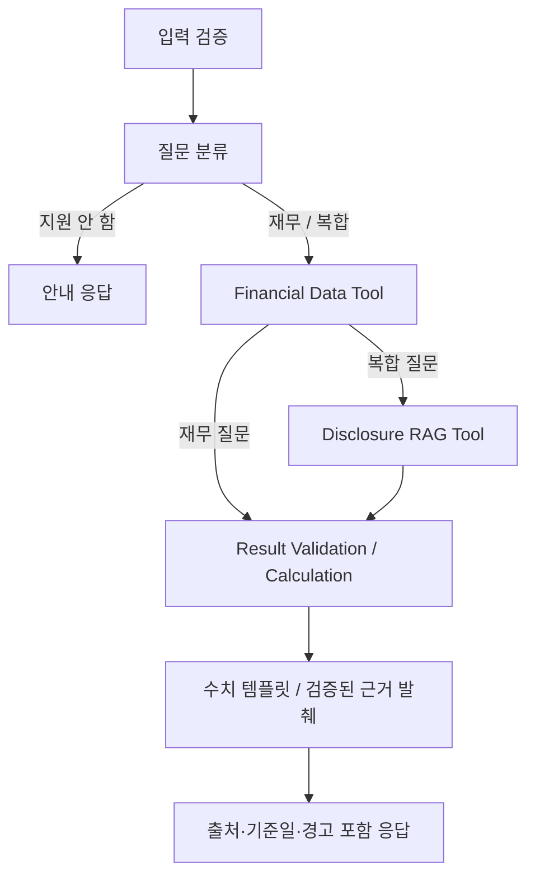

# FinSight AI

**공시 근거와 검증 가능한 계산을 결합한 금융 분석 Agent.** FnGuide 금융 AI Agent 개발 직무 지원을 위한 개인 포트폴리오입니다. FnGuide와 제휴하거나 FnGuide 데이터를 사용하는 서비스는 아닙니다.

> 현재 상태(2026-10-29): 실제 데이터 Baseline을 실행했습니다. 연결 재무 원문 수치 12/12, 계산 가능한 비율 17/17이 자동 대조에서 일치했습니다. 실제 RAG 24개 질문을 실행했으나 의미적 적합성은 사람 검토 전입니다. 현재 공시 XML 정제에 실제 입력 회귀가 있어 수집 테스트는 실패합니다. P0 전체 완료나 운영 배포 완료로 주장하지 않습니다. [Baseline 결과와 재현 방법](docs/BASELINE.md)

## 해결하려는 문제

LLM에 기업 실적을 직접 물으면 기간, 연결/별도, 단위, 출처가 뒤섞일 수 있습니다. FinSight는 재무 수치를 OpenDART에서 가져오고 Python `Decimal`로 계산합니다. 실적 원인 질문은 기업·회계연도가 맞는 공시에서만 근거를 찾고, 근거가 없으면 답변을 제한합니다.

## 구현 범위

| 기능 | 구현 | 검증 상태 |
|---|---|---|
| 기업 고유번호 ZIP 조회·종목코드 매핑 | OpenDART corpCode.xml | Mock HTTP 테스트 및 실제 조회 |
| 연간 연결/별도 재무 조회 | fnlttSinglAcntAll.json, 11011, CFS/OFS | 연결 2023~2025 실제 원문 자동 대조; 별도는 오프라인 테스트 |
| 매출·영업이익·이익률·전년 증가율 | Decimal, 결측/0/적자 처리 | 단위·통합 테스트 |
| Agent | Typed State, 조건부 라우팅, 역할별 도구, 검증 | 실제 LangGraph 실행 |
| 공시 수집 및 RAG | 공식 list.json/document.xml → 청크 → OpenAI → Chroma | 기존 실제 833개 청크로 검색 실행; 현재 XML 정제 수집 회귀 발견 |
| 공시 답변 | LLM 구조화 출력으로 인용문 선택 → 원문 일치 검증 | 실제 24개 질문 실행, 채택 인용 6개 존재 확인; 의미적 지원은 검토 전 |
| API/UI | FastAPI / Streamlit 비교표·차트·출처·오류 | 테스트 및 로컬 smoke 결과 참조 |
| Docker/CI/클라우드/MCP | 미구현 | P0 실제 검증 후 P1 |

지원 범위는 삼성전자와 SK하이닉스, 완료된 연간 회계기간(2015년 이후), 한 요청 최대 4개 연도입니다. 전년 대비 계산 시 이전 연도를 추가하므로 최대 기간에 포함됩니다. '최근'은 현재 서울 기준 연도의 전년도이며 미공시라고 더 오래된 데이터로 조용히 대체하지 않습니다. 분기·순이익·주가·투자 추천은 지원하지 않습니다.

## 빠른 시작 — 키 없는 Mock 실행

Python **3.11 권장**. 최초 로컬 검증은 설치되어 있던 Python 3.12.10으로 수행했습니다. Python 3.11 및 Linux 환경은 별도 검증이 필요합니다.

```powershell
py -3.11 -m venv .venv
.\.venv\Scripts\python.exe -m pip install -e ".[dev]"
Copy-Item .env.example .env
.\.venv\Scripts\python.exe scripts/doctor.py
```

Python 3.11 런처가 없다면 설치된 호환 Python으로 `python -m venv .venv`를 사용할 수 있습니다. Linux/macOS에서는 `.venv/bin/python`으로 바꾸세요. 설정 진단은 키 존재 여부만 출력합니다.

터미널 1:

```powershell
.\.venv\Scripts\python.exe -m uvicorn finsight.api:app --host 127.0.0.1 --port 8000
```

터미널 2:

```powershell
.\.venv\Scripts\python.exe -m streamlit run ui/app.py --server.address 127.0.0.1 --server.headless true
```

[대시보드](http://127.0.0.1:8501) · [API 문서](http://127.0.0.1:8000/docs)

UI에 키를 입력하지 않습니다. UI 프로세스는 서버에 질문만 보내고 실제 모드는 서버 환경변수로 결정합니다. UI 서버 주소를 변경할 때는 `FINSIGHT_API_URL`을 프로세스 환경변수로 설정하세요.

## 실제 데이터 모드

`.env`에서 `FINSIGHT_MODE=live`, `DART_API_KEY`, `OPENAI_API_KEY`를 설정합니다. 키를 채팅·GitHub·스크린샷에 포함하지 마세요. DART 키가 없으면 서버 시작이 실패하며 Mock으로 대체하지 않습니다. 재무 질문에는 OpenAI 호출이 필요하지 않습니다.

공시 검색 전 해당 기업·연도의 사업보고서를 명시적으로 수집합니다. OpenAI 임베딩 비용이 발생하며 정제된 공시 텍스트가 OpenAI로 전송됩니다.

```powershell
.\.venv\Scripts\python.exe scripts/ingest.py --company 삼성전자 --year 2024
.\.venv\Scripts\python.exe scripts/ingest.py --company SK하이닉스 --year 2024
```

2023~2025년 전체 비교의 원인 분석에는 해당 기업·연도 각각 수집이 필요합니다. 수집은 공식 OpenDART API가 제공하는 문서에 한정하며 로그인 우회나 웹 페이지 크롤링을 하지 않습니다. API 키 이용 조건과 제공 문서의 재배포 조건을 확인하고, 원문·벡터 DB는 Git에 커밋하지 않습니다.

## 재현 가능한 질문·답변 예시

아래는 **실제 실행한 Mock 경로의 합성 데이터**입니다. 실제 기업 재무 실적이 아닙니다.

질문: `삼성전자의 2024년 영업이익이 전년 대비 얼마나 증가했어?`

- 합성 2023년 영업이익: 10,000,000,000원
- 합성 2024년 영업이익: 18,000,000,000원
- Python 계산: `(18 - 10) / 10 × 100 = 80.00%`
- 출처: `MOCK-삼성전자-2023`, `MOCK-삼성전자-2024` (실제 URL 없음)

질문: `SK하이닉스 2024 영업이익 전년 대비 증가율`

합성 전기 영업손실 -50억원, 당기 영업이익 150억원 → **흑자 전환**, 증가율 미산출.

질문: `SK하이닉스 2020 실적 원인`

Mock에 해당 연도 데이터와 문서가 없어 원인을 추측하지 않고 결측·근거 부족을 안내합니다.

실제 데이터 답변 원본은 [Baseline 실행 결과](evaluation/baseline/2026-10-29/rag-results.json)에 있습니다. 금융 수치의 자동 원문 대조와 공시 근거의 사람 적합성 검토는 구분합니다.

## 테스트와 평가

2026-10-29 Baseline: 기존 회귀 **56 passed, 2 skipped**, 기존 실제 연동 **1 passed, 1 failed**,
평가 도구 **12 passed**. 현재 실제 수집 실패 원인과 검토가 필요한 RAG 지표는 [Baseline 문서](docs/BASELINE.md)에 기록했습니다. 서비스 워크플로·계산·API 계약은 변경하지 않았습니다.

2026-10-27 최종 로컬 실행: **53 passed, 2 skipped**, Mock 질문 평가 **24/24**,
FastAPI/Streamlit HTTP smoke 통과, Ruff·compileall·pip check 통과.
건너뛴 2개는 실제 공급자 연동 테스트입니다.

```powershell
.\.venv\Scripts\python.exe -m pytest -q --junitxml=evaluation/pytest-results.xml
.\.venv\Scripts\python.exe scripts/evaluate.py
.\.venv\Scripts\python.exe scripts/smoke.py
.\.venv\Scripts\python.exe -m ruff check finsight ui scripts tests
```

- [평가 질문 24개](evaluation/questions.json) / [실행 결과](evaluation/results.json)
- [테스트 원본 결과](evaluation/pytest-results.xml) / [서버 smoke 결과](evaluation/smoke-results.json)
- [검증 방법·제약](docs/VALIDATION.md)

Mock 평가는 라우팅·표 행 수·합성 표시·인용 일치·결측 거부·일부 계산 정답을 확인합니다. **24/24는 실제 금융 정확도나 의미 검색 품질의 점수가 아닙니다.** Mock은 256차원 문자 해시 임베딩, 실제 모드는 OpenAI 임베딩을 사용하며 저장 컬렉션도 분리됩니다.

실제 호출 테스트는 비용과 인증키가 필요해 기본적으로 skip합니다:

```powershell
$env:RUN_LIVE_TESTS="1"
.\.venv\Scripts\python.exe -m pytest tests/test_live.py -v
```

## 구조와 기술 선택

```text
finsight/
  config.py       환경변수·설정 검증
  models.py       입력/응답/출처 스키마
  dart.py         제한·타임아웃·재시도를 가진 DART 클라이언트
  finance.py      금액 정규화·기간/중복 검증·Decimal 계산
  rag.py          원문 정제·청크·임베딩·Chroma
  workflow.py     Typed State와 단일 LangGraph
  api.py          입력 검증·전역 호출 제한·오류 경계
  mock.py         실제 데이터와 분리된 합성 fixture
ui/app.py         Streamlit
scripts/          설정 진단·공시 수집·평가·HTTP smoke
tests/            계산·DART·RAG·워크플로·API·UI·실제 연동 검사
evaluation/       질문·실제로 생성한 검증 결과
docs/             설계·검증·배포 준비·한계
```

FastAPI는 타입 기반 API 계약, LangGraph는 분기와 실행 상태, Chroma는 로컬 영속 벡터 검색, Streamlit은 짧은 일정의 데이터 UI에 사용했습니다. 핵심 숫자 답변을 LLM에서 분리하여 비용·환각·재현성 문제를 줄였습니다. 제한된 MVP에서 Multi-Agent와 자유로운 LLM 도구 선택은 도입하지 않았습니다. 자세한 선택과 단점은 [기술 결정 문서](docs/DECISIONS.md)를 참고하세요.

## 아키텍처





## 한계와 제출 시 강조점

강조할 구현 성과는 **회계기간·중복 금액 검증**, **적자/0/결측을 고려한 계산**, **단일 상태 그래프의 조건부 도구 실행**, **기업·연도별 RAG 필터**, **출처와 원문 인용 일치 검증**, **오프라인 회귀 테스트와 실제 연동 테스트 분리**입니다.

현재 라우팅은 명시적 규칙이며 자연어 전체를 이해하지 않습니다. 회계 기준은 연결/별도 및 통화를 구분하나 회계정책 변경이나 재작성 비교 가능성을 자동 보장하지 않습니다. 공시 인용은 관련 문장 발췌이며 완성도 높은 인과 요약이나 독립적 사실검증을 의미하지 않습니다.

[배포 준비 가이드](docs/DEPLOYMENT.md) · [한계 및 다음 단계](docs/LIMITATIONS.md)

## 공식 데이터·기술 문서

- [OpenDART 전체 재무제표](https://opendart.fss.or.kr/guide/detail.do?apiGrpCd=DS003&apiId=2019020)
- [OpenDART 공시 검색](https://opendart.fss.or.kr/guide/detail.do?apiGrpCd=DS001&apiId=2019001)
- [OpenDART 공시 원문](https://opendart.fss.or.kr/guide/detail.do?apiGrpCd=DS001&apiId=2019003)
- [LangGraph StateGraph](https://reference.langchain.com/python/langgraph/graph/state/StateGraph/add_conditional_edges)
